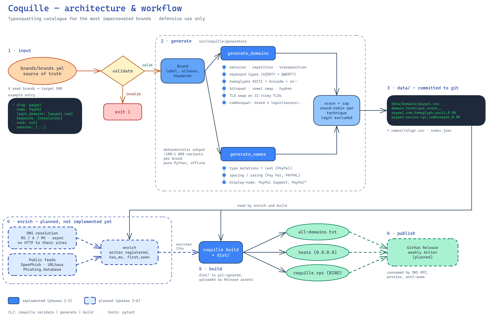

# Coquille

A catalogue of typosquatted **names** and **domains** for the most impersonated brands, plus the
tool that generates it. Built for defenders: blocklists, detection rules, brand monitoring and
takedown triage.

> **Status: early development.** The generator, validator, per-brand export and blocklist builder
> work today. The list currently holds **4 seed brands**; the target is the **top 500** most
> impersonated brands. DNS/feed enrichment and the release automation are planned, not built yet.



The editable diagram is [`doc/architecture.excalidraw`](doc/architecture.excalidraw).

## What you get

For each brand in [`brands/brands.yml`](brands/brands.yml):

| Output | Path | Content |
|---|---|---|
| Domain variants | `data/domains/<slug>.csv` | `domain, technique, score, registered, first_seen, sources` |
| Name variants | `data/names/<slug>.csv` | `name, technique, score` (handles, app names, e-mail display names) |
| Index | `data/index.json` | Counts per brand, generation timestamp |

`registered`, `first_seen` and `sources` stay empty until the (planned) enrichment step fills them.

Aggregated blocklists are built on demand into `dist/` (git-ignored, meant to be published as
release assets):

- `all-domains.txt`: one domain per line
- `hosts`: `0.0.0.0 <domain>` entries
- `coquille.rpz`: DNS Response Policy Zone (NXDOMAIN for the name and its subdomains)

## Techniques

Applied to the brand's domain label (and aliases):

- omission, repetition, transposition
- keyboard-neighbour insertion/replacement (QWERTY **and** AZERTY)
- homoglyphs: ASCII look-alikes (`l`→`1`, `m`→`rn`, …) and Unicode confusables, emitted as
  punycode (`xn--…`)
- bitsquatting, vowel swap, hyphenation
- TLD swap over 32 TLDs often seen in abusive registrations
- combosquatting: brand ± keywords such as `login`, `secure`, `support` (EN and FR), plus
  brand-specific keywords from `brands.yml`

Applied to brand **names**: the typo and homoglyph mutations above, leet speak, casing and spacing
variants, and display-name spoofing (`PayPal Support`, `PayPal™`).

Each technique has a plausibility weight. Output is capped per brand (default 1,000 domains and
300 names) using a **round-robin across techniques**, so one prolific technique such as
combosquatting cannot crowd out the others. Domains that belong to the brand
(`legit_domains`) are never listed. Generation is deterministic: same input, same output.

## Quick start

Requires Python 3.10+.

```bash
python3 -m venv .venv && source .venv/bin/activate
pip install -e ".[dev]"

coquille validate                      # check brands/brands.yml
coquille generate                      # all brands -> data/
coquille generate --brand paypal       # a single brand
coquille generate --cap 500            # lower the per-brand domain cap
coquille build                         # data/ -> dist/ (txt, hosts, RPZ)

pytest                                 # run the tests
```

Without installing, `PYTHONPATH=src python3 -m coquille.cli <command>` works too.

## Adding or fixing a brand

Edit [`brands/brands.yml`](brands/brands.yml). Every entry needs a justification:

```yaml
- slug: paypal                 # unique, [a-z0-9-]
  name: PayPal
  category: payments
  legit_domains: [paypal.com, paypal.me]   # allow-list, never emitted as malicious
  aliases: []                              # other names the brand goes by
  keywords: [resolution, refund]           # brand-specific combosquat words
  tlds_risk: []                            # optional override of the risky-TLD list
  rank: null                               # leave null unless a public source gives one
  sources: ["<public report that lists this brand>"]
```

Then run `coquille validate` and `pytest`. A brand without at least one source, with an invalid
domain, or with a duplicate slug or domain is rejected.

## Repository layout

```
brands/brands.yml        source of truth: the brands covered
src/coquille/
  models.py              Brand / Variant, brands.yml loading and validation
  generators/            techniques, static tables, scoring and capping
  export.py              per-brand files, index, aggregated blocklists
  cli.py                 validate | generate | build
data/                    generated catalogue (committed)
dist/                    aggregated blocklists (git-ignored)
doc/                     architecture diagram
tests/
```

## Roadmap

- [x] Generators, validator, per-brand export, hosts/RPZ builder
- [ ] Compile the top-500 brand list from public reports, with a cited source per brand
- [ ] Full generation for all brands
- [ ] Enrichment: async DNS (NS/A/MX, no HTTP contact with the sites) and cross-checking against
      public phishing feeds. Only matches against our variants are stored, tagged with the source.
- [ ] Weekly GitHub Action publishing aggregated blocklists as release assets
- [ ] French README

## Responsible use

This project exists to **detect and block** impersonation. It does not register domains, host
content or contact the listed sites.

- A listed domain is a *lookalike candidate*, not proof of abuse. Most generated variants are
  unregistered, and some registered ones may be legitimate. Review before blocking or reporting.
- Do not use this data to register domains or to build phishing infrastructure.
- Brand owners or domain holders who want an entry corrected or removed can open an issue.
- Third-party feeds used for enrichment have their own terms (for example, some are
  non-commercial only). Check them before redistributing derived data.

## License

The code license (MIT) is declared in `pyproject.toml`; a `LICENSE` file and the license for the
generated data (CC0 or CC-BY) are still to be decided before publication.
